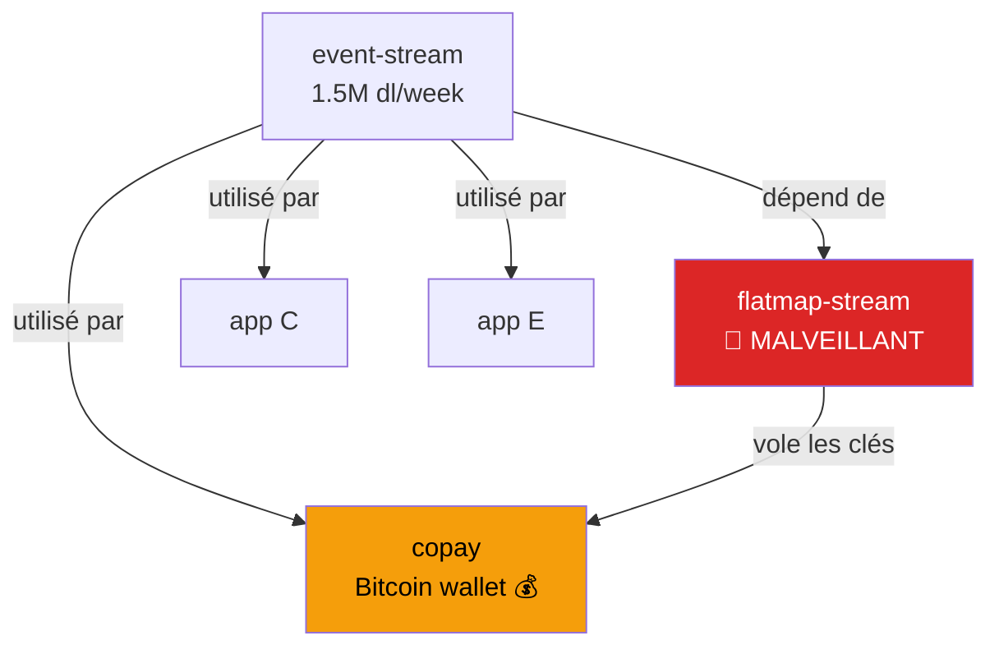
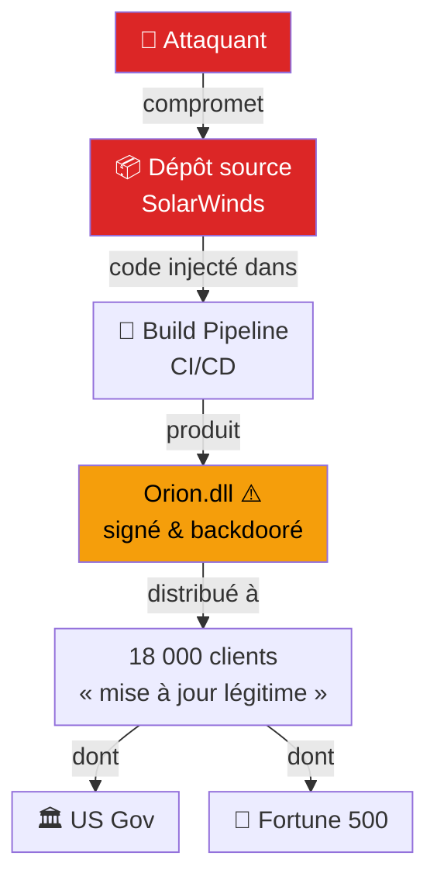

---
# try also 'default' to start simple
theme: seriph
# random image from a curated Unsplash collection by Anthony
# like them? see https://unsplash.com/collections/94734566/slidev
background: https://cover.sli.dev
# some information about your slides (markdown enabled)
title: "Cours 0 — Introduction Module DevSecOps"
info: |
  ## DevSecOps — Université de Rennes / IRISA / DiverSE
  Cours 0 : Introduction DevSecOps 
  Olivier Barais
class: text-center
# https://sli.dev/features/drawing
pdf: true
export: true
drawings:
  persist: false
# slide transition: https://sli.dev/guide/animations.html#slide-transitions
transition: slide-left
# enable Comark Syntax: https://comark.dev/syntax/markdown
comark: true
download: true
# duration of the presentation
duration: 3min
---

# Module DevSecOps
## 


---
layout: image-right
image: /img/olivierbarais.png
---

# Olivier Barais

**Prof. @Univ. Rennes — IRISA**,  [🌐](https://olivier.barais.fr)


## Mes domaines d'expertise

- 🔒 Secure Software Supply Chain
- 🏗️ Dynamic software architecture
- 🧩 Software language engineering
- 🌐 Distributed systems
- ☁️ Cloud computing
- 📐 Model-driven engineering


---
layout: center
class: text-center
---

# Objectif de ce cours

<div class="mt-8 text-xl max-w-2xl mx-auto leading-relaxed">
Le but de cette partie du cours est de comprendre les notions de
<span class="text-blue-400 font-bold">DevOps</span>,
<span class="text-green-400 font-bold">DevSecOps</span>,
<span class="text-purple-400 font-bold">Software Supply Chain</span>,
<span class="text-yellow-400 font-bold">SBOM</span>,
<span class="text-red-400 font-bold">Software Supply Chain Attack</span>…
</div>

<div class="mt-10 p-5 bg-white/10 rounded-xl text-lg max-w-2xl mx-auto">
À la fin de ce module, vous aurez une meilleure compréhension des <strong>techniques logicielles</strong> mises en œuvre pour développer des systèmes modernes et des <strong>risques associés</strong>.
</div>

---
layout: section
---

# Pourquoi est-ce important ?

## Le regard d'un futur RSSI

---

# Pourquoi est-ce important pour un RSSI ?

<div class="grid grid-cols-1 gap-3 mt-4">

<div v-click class="p-3 border-l-4 border-red-400 bg-red-900/20 rounded-r-lg">

**🎯 Vous gérerez un SI composé de logiciels en perpétuelle évolution**

En tant que futur RSSI, vous aurez en charge la sécurisation d'un **Système d'Information** composé d'applicatifs propriétaires et open source en perpétuelle évolution.

</div>

<div v-click class="p-3 border-l-4 border-orange-400 bg-orange-900/20 rounded-r-lg">

**🔑 Les développeurs ont des droits importants… et c'est une cible**

Les développeurs, les environnements de tests, etc. ont tendance à avoir des **droits importants** au sein d'un système d'information. → **Cible d'attaque tentante.**

</div>

<div v-click class="p-3 border-l-4 border-yellow-400 bg-yellow-900/20 rounded-r-lg">

**🤝 Les développeurs open-source sont par défaut optimistes**

Les développeurs (en particulier open-source) sont par défaut **optimistes**. → **Cible d'attaque tentante.**

</div>

</div>

---
layout: two-cols-header
backgroundSize: contain
---


# Supply Chain Open Source & Sécurité


::left::

<div class="mt-4">

> *"Open source software is pervasive in **data centers, consumer devices, and applications**. Securing open source supply chains requires a combination of automated tooling, best practices, education, and collaboration."*
>
> — **OpenSSF**

</div>

<div class="mt-6 space-y-2 text-sm">

<div v-click class="p-2 bg-red-900/30 rounded">
📅 **Mars 2022** — node-ipc and peacenotwar (CVE-2022-23812)
</div>

<div v-click class="p-2 bg-orange-900/30 rounded">
📅 **Déc. 2021** — Log4Shell (CVE-2021-44228)
</div>

<div v-click class="p-2 bg-yellow-900/30 rounded">
📅 **Nov. 2018** — Attack on NPM package event-stream
</div>

</div>

::right::

<div class="text-center">

</div>


---

# Une autre façon de comprendre le problème

## Pour un futur RSSI

<div class="grid grid-cols-2 gap-8 mt-6 items-center">

<div>

<div class="text-center text-5xl mb-4">🏗️</div>

Toute l'infrastructure numérique moderne repose sur **des projets open-source maintenus par quelques bénévoles**.

Un seul paquet compromis peut affecter **des milliers** d'applications et de systèmes.

<div v-click class="mt-4 p-3 bg-red-900/30 border border-red-400/40 rounded-lg text-center font-bold ">
Le maillon faible est souvent invisible.
</div>

</div>

<div class="text-center">

</div>

</div>

---
layout: section
---

# Quelques incidents marquants

## La Supply Chain en action

---

# Nov. 2018 — Attaque NPM : `event-stream`

<div class="grid grid-cols-2 gap-8 mt-4">

<div>


**1,5+ million de téléchargements/semaine**, 1600 paquets dépendants 


<v-clicks>

- Un utilisateur malveillant (`right9control`) a **demandé la propriété** au mainteneur original et a réussi
- A ajouté `flatmap-stream` comme **dépendance malveillante**
- Le code malveillant n'était présent que dans le **paquet NPM publié**, pas dans le dépôt Git
- Le malware ne s'activait que dans le contexte d'un **build de release** du wallet Bitcoin `copay`
- Découvert **uniquement par hasard**

</v-clicks>

</div>

<div class="mt-4">



<div class="text-xs opacity-50 mt-2">
Réf : theregister.co.uk/2018/11/26/npm_reco_bitcoin_stealer
</div>

</div>
</div>

---

# Mars 2022 — `node-ipc` & peacenotwar (CVE-2022-23812)

<div class="grid grid-cols-2 gap-6 mt-4">

<div>

Les versions 10.1.1 et 10.1.2 du module npm populaire **`node-ipc`** contenaient du code **effaçant le contenu du système de fichiers** des IPs géolocalisées en Biélorussie ou en Russie.

<v-clicks>

- Code malveillant ajouté dans Git **[3]**, mais l'historique a été réécrit
- **Pas d'attaquants externes** — des mainteneurs open-source politisés et mécontents
- Distribué à travers Vue CLI, qui dépend de node-ipc

</v-clicks>

</div>

<div>


<div class="font-mono text-xs bg-gray-900 rounded-lg p-2 text-green-300 overflow-auto max-h-20">

```
root@40033e949e71:/usr/src/goof# node index.js
geo ip request url::
    https://api.ipgeolocation.io/ipgeo
current path:
    ./
up one:
    ../
up two:
    ../../
root:
    /
key from geo ip response to look for:
    country_name
country name to act on:
    russia
country name to act on:
    belarus
json passed into function:
    {"country_name":"russia"}
the country name in the json is one we care about:
    true
the character that will be used to overwrite all files:
    ❤️
```

</div>
</div>

</div>

<div class="mt-2 text-xs opacity-50">
Réf : [1] snyk.io/blog/peacenotwar-malicious-npm-node-ipc-package-vulnerability
</div>

---
layout: two-cols-header
---

# 2020 — SolarWinds : l'attaque qui a tout changé

::left::


<v-clicks>

- Code injecté dans le **processus de build**
- Binaire signé avec une **backdoor dormante 14 j**
- Trafic réseau **légitime** (normal)
- **18 000 clients** dont armée US, Pentagone, État, NSA, cabinets comptables
- Impact sur le **cours de l'action**

</v-clicks>


::right::




<style>
/* style.css */
.slidev-layout.two-cols-header {
  grid-template-columns: 4fr 2fr;
}
li {
  font-size: 0.8em;
}
</style>


---

# 2023 — AI Package Hallucination

<div class="grid grid-cols-2 gap-8 mt-6 items-center">

<div>

### Pouvez-vous faire confiance aux recommandations de ChatGPT ?

<v-clicks>

- **Juin 2023** — Les LLM "hallucinent" des noms de paquets qui **n'existent pas**
- Un attaquant **publie réellement** le paquet avec ce nom
- La prochaine fois que quelqu'un pose la même question au LLM… il installe le malware

</v-clicks>

<div v-click class="mt-6 p-3 bg-red-900/30 border border-red-400/40 rounded-lg">

**Nouvelle surface d'attaque :** les outils d'IA génèrent du code qui référence des dépendances non vérifiées.

</div>

</div>

<div class="text-center">
<div class="p-4 bg-gray-900 rounded-xl border border-gray-600">
<div class="text-sm text-gray-400 mb-2">NEW ATTACK TECHNIQUE ALERT</div>
<div class="text-2xl font-bold text-orange-400">AI Package<br/>Hallucination</div>
<div class="text-sm text-gray-300 mt-2">VOYAGER18 · VULCAN</div>
</div>

<div class="mt-4 text-sm opacity-60 italic">
"Can you trust ChatGPT's package recommendations?"
</div>
</div>

</div>

---
zoom: 0.9
---
# Mars 2024 — XZ Utils : backdoor dans liblzma (CVE-2024-3094)

<div class="grid grid-cols-2 gap-6 mt-4">

<div>

Découverte **par hasard** : des connexions SSH anormalement lentes alertent un contributeur de PostgreSQL (**Andres Freund**) sur une machine Debian instable.

<v-clicks>

- Backdoor **ultra-sophistiquée** cachée dans **liblzma** (xz 5.6.0/5.6.1), ciblant **sshd** via systemd
- Attaque en **5 étages** avec obfuscation : stub de script, tests modifiés, binary `good / bad` d'extraction
- Infiltration via un faux mainteneur **« Jia Tan »** gagnant la confiance pendant **~3 ans** (sock puppet)
- Valeur d'analyse ajoutée **dans les artefacts** (`.tar.xz`) **et non** dans le dépôt Git

</v-clicks>


</div>

<div>

<div class="p-4 bg-gray-900 rounded-xl border border-gray-600 text-center">
<div class="text-sm text-gray-400 mb-2">SUPPLY CHAIN ATTACK</div>
<div class="text-2xl font-bold text-red-400">XZ Utils<br/>Backdoor 2024</div>
<div class="text-sm text-gray-300 mt-2">CVE-2024-3094 · liblzma · sshd</div>
</div>

<div class="mt-4 text-sm opacity-70">

- **Cible :** connexions SSH (`sshd` via `systemd` → `liblzma`)
- **Impact :** porte dérobée RCE dans les accès distants
- **Détection :** performances SSH anormales
- **Chaîne :** mainteneur compromis → lib tarball → systemd

</div>

</div>

</div>

<div v-click class="mt-1 p-1 bg-red-900/30 border border-red-400/40 rounded-lg">

**Leçon :** compromission de mainteneur légitime + build non traçable = risque maximal (1 bailleur de fonds maintenait xz bénévolement).

</div>


<div class="mt-2 text-xs opacity-50">
Réf : [1] CVE-2024-3094 · [2] analyse d'Andres Freund (PostgreSQL) · [3] détails techniques (schémas de décompression)
</div>

<style>
p {
  font-size: 0.95em;
}

li {
  font-size: 0.95em;
}

</style>


---
layout: center
class: text-center
---

# Ce n'est pas une liste exhaustive…

<div class="mt-8 grid grid-cols-3 gap-6 max-w-3xl mx-auto">

<div class="p-4 bg-red-900/30 border border-red-400/40 rounded-lg">
<div class="text-2xl mb-2">📦</div>
<div class="font-bold">Dépendances</div>
<div class="text-sm mt-1 opacity-70">left-pad, colors.js, faker.js, ua-parser-js…</div>
</div>

<div class="p-4 bg-orange-900/30 border border-orange-400/40 rounded-lg">
<div class="text-2xl mb-2">🔑</div>
<div class="font-bold">Clés & Secrets</div>
<div class="text-sm mt-1 opacity-70">tokens CI/CD, credentials dans des dépôts publics…</div>
</div>

<div class="p-4 bg-yellow-900/30 border border-yellow-400/40 rounded-lg">
<div class="text-2xl mb-2">🏗️</div>
<div class="font-bold">Pipeline CI/CD</div>
<div class="text-sm mt-1 opacity-70">XZ Utils 2024, SolarWinds, Codecov…</div>
</div>

<div class="p-4 bg-purple-900/30 border border-purple-400/40 rounded-lg md:col-span-3">
<div class="text-2xl mb-2">🤖</div>
<div class="font-bold">Agentique</div>
<div class="text-sm mt-1 opacity-70">agents &amp; IA générative : hallucinations de packages, dépendances synthétiques, attaques par prompt injection, agents autonomes malicieux, exfiltration via tooling…</div>
</div>

</div>

<div class="mt-10 text-xl opacity-80">
La question n'est plus <em>si</em> votre supply chain sera attaquée,<br>
mais <em>quand</em> — et comment vous le saurez.
</div>

---
layout: section
---

# Structure de ce module

## Ce que vous allez apprendre

---
zoom: 0.85
---
# Plan de l'UE DevSecOps

<div class="grid grid-cols-3 gap-6 mt-4 text-sm">

<div class="p-5 border border-blue-400/40 rounded-xl bg-blue-900/10">

### 🚀 DevOps — Cours 1 à 5

<ul class="mt-2 space-y-1.5 list-none p-0">
<li><a href="https://olivier.barais.fr/devsecops.module1" target="_blank">1 · Introduction DevOps</a></li>
<li><a href="https://olivier.barais.fr/devsecops.module2" target="_blank">2 · Git &amp; GitFlow</a></li>
<li><a href="https://olivier.barais.fr/devsecops.module3" target="_blank">3 · Gestion de dépendances</a></li>
<li><a href="https://olivier.barais.fr/devsecops.module4" target="_blank">4 · CI/CD</a></li>
<li><a href="https://olivier.barais.fr/devsecops.module5" target="_blank">5 · Conteneurs &amp; images</a></li>
</ul>

</div>

<div class="p-5 border border-purple-400/40 rounded-xl bg-purple-900/10">

### 🔐 DevSecOps — Cours 6 à 9

<ul class="mt-2 space-y-1.5 list-none p-0">
<li><a href="https://olivier.barais.fr/devsecops.module6" target="_blank">6 · Incidents &amp; contre-mesures</a></li>
<li><a href="https://olivier.barais.fr/devsecops.module7" target="_blank">7 · Attaques Supply Chain Open Source</a></li>
<li><a href="https://olivier.barais.fr/devsecops.module8" target="_blank">8 · Builds reproductibles</a></li>
<li><a href="https://olivier.barais.fr/devsecops.module9" target="_blank">9 · GNU Guix &amp; environnements</a></li>
</ul>

</div>

<div class="p-5 border border-emerald-400/40 rounded-xl bg-emerald-900/10">

### 🤖 Nouveaux risques — Ère agentique

<p class="mt-2">Les nouveaux risques à l'heure de l'agentique.</p>

<ul class="mt-2 space-y-1.5 list-none p-0">
<li><a href="https://olivier.barais.fr/devsecops.module10" target="_blank">10 · Agentique &amp; risques émergents</a></li>
</ul>

</div>

</div>

<div class="mt-4 text-sm opacity-60">
+ 4 TPs pratiques · 1 Projet de groupe · 1 CC sur table
</div>

---

# Compétences à l'issue de ce module

<div class="grid grid-cols-1 gap-2 mt-3">

<div v-click class="p-2 flex gap-3 items-start border border-blue-400/30 rounded-lg bg-blue-900/10">
<div class="text-xl min-w-7">🏭</div>
<div class="text-sm">
<strong>C1</strong> — Comprendre une <strong>chaîne de production logicielle moderne</strong> (gestion de versions, dépendances, intégration continue…) et pouvoir interagir avec les architectes en charge de sa maintenance.
</div>
</div>

<div v-click class="p-2 flex gap-3 items-start border border-green-400/30 rounded-lg bg-green-900/10">
<div class="text-xl min-w-7">⚠️</div>
<div class="text-sm">
<strong>C2</strong> — Expliquer les <strong>risques et enjeux</strong> associés à la sécurisation de la chaîne de production logicielle.
</div>
</div>

<div v-click class="p-2 flex gap-3 items-start border border-yellow-400/30 rounded-lg bg-yellow-900/10">
<div class="text-xl min-w-7">🔍</div>
<div class="text-sm">
<strong>C3</strong> — Mener une <strong>analyse des risques d'attaques</strong> sur une supply chain logicielle.
</div>
</div>

<div v-click class="p-2 flex gap-3 items-start border border-orange-400/30 rounded-lg bg-orange-900/10">
<div class="text-xl min-w-7">🛡️</div>
<div class="text-sm">
<strong>C4</strong> — Mettre en place des <strong>contre-mesures intégrées à la CI/CD</strong> (analyse statique, analyse de dépendances, génération de SBOM).
</div>
</div>

<div v-click class="p-2 flex gap-3 items-start border border-red-400/30 rounded-lg bg-red-900/10">
<div class="text-xl min-w-7">🎯</div>
<div class="text-sm">
<strong>C5</strong> — En jouant le rôle d'un attaquant, s'approprier les <strong>techniques d'attaque</strong> utilisées pour compromettre une chaîne de production logicielle.
</div>
</div>

</div>

---

# Évaluation

<div class="grid grid-cols-3 gap-8 mt-10">

<div class="p-6 border border-blue-400/40 rounded-xl text-center bg-blue-900/10">

### 🧪 Travaux Pratiques

4 TPs pratiques tout au long du semestre

Évaluation sur la qualité des rendus et la démarche

</div>

<div class="p-6 border border-purple-400/40 rounded-xl text-center bg-purple-900/10">

### 📝 Contrôle de Connaissances

Un CC sur table

Couvre l'ensemble des 9 cours

</div>

<div class="p-6 border border-emerald-400/40 rounded-xl text-center bg-emerald-900/10">

### 🔍 Projet Audit

Vous jouerez le rôle d'**auditeur** sur un projet **open source**, en évaluant les **risques majeurs** et les **contre-mesures** à appliquer.

</div>

</div>

<div class="mt-10 p-4 bg-indigo-900/20 rounded-lg text-center">

L'objectif n'est pas de mémoriser des commandes, mais de **comprendre les enjeux** et de **raisonner** sur les risques et les pratiques.

</div>

---
layout: section
---

# ❓ Questions ?

<div class="mt-6 text-xl opacity-80">

Des questions sur la **supply chain** logicielle, le **DevSecOps** ou les **risques** abordés ?

</div>

<div class="mt-8 text-sm opacity-50">
Olivier Barais · Module DevSecOps
</div>

